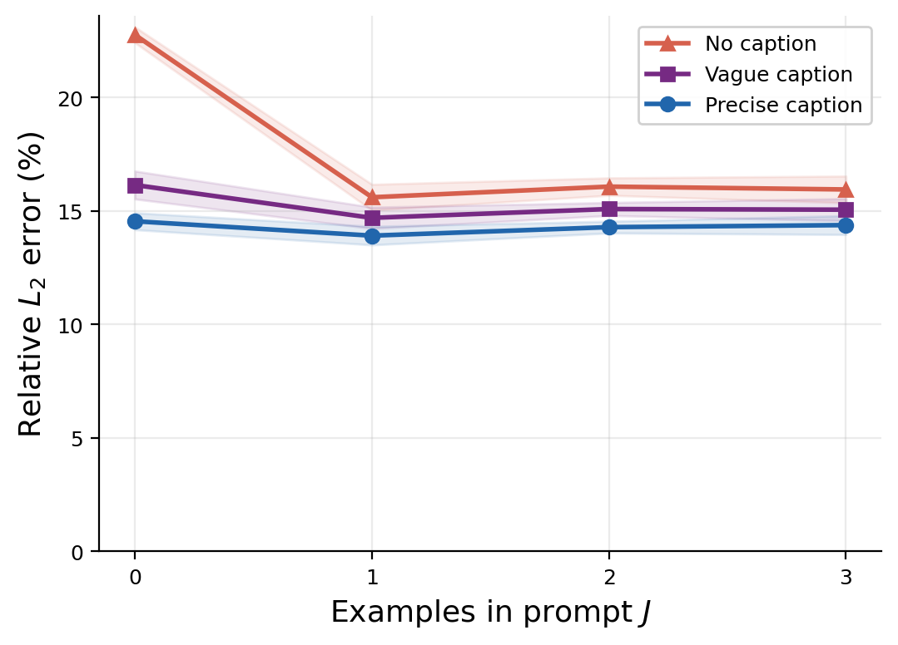

# Burgers ICON-LM Example

This repository contains a small, self-contained example of **In-Context
Operator Networks with Language captions (ICON-LM)** applied to the 1D
viscous Burgers equation:

```
u_t + u·u_x = ν·u_xx
```

The hidden operator is the viscosity ν. Given a few demonstration
trajectories (input → output pairs) for a fixed ν, the model predicts the
output trajectory for a new query input — without any weight updates or
fine-tuning. Optional natural-language captions ("precise" or "vague"
descriptions of ν) can be included in the prompt to study how much
language conditioning helps in-context prediction.

This example is based on the ICON-LM approach described in:

> Yang, L., Liu, S., Osher, S. J. *Fine-Tune Language Models as Multi-Modal
> Differential Equation Solvers*.
> [https://ww3.math.ucla.edu/wp-content/uploads/2024/05/ICON_LM_202405-1.pdf](https://ww3.math.ucla.edu/wp-content/uploads/2024/05/ICON_LM_202405-1.pdf)

All code lives in [`burgers-example/`](burgers-example/).

## What's in `burgers-example/`

| File | Purpose |
|---|---|
| `data.py` | Generates 1D viscous Burgers trajectories via a spectral (FFT) RHS + SciPy RK45 solver, for a range of log-uniform ν values. Also builds natural-language captions describing each ν. |
| `model.py` | Defines `ICONLM`, a small transformer that operates on sequences of `(condition, target, query)` token blocks, plus the attention-mask builder `build_mask`. |
| `train.py` | Trains the model: samples prompts (J demonstrations + 1 query) per operator, with sentence-embedding captions mixed in. Writes `checkpoint.pt`, `test_data.npz`, and `metrics.tex`. |
| `evaluate.py` | Evaluates the trained model: (1) forward context-scaling — relative L2 error vs. number of demo shots, for precise/vague/no-caption prompts; (2) inverse viscosity estimation via nearest-centroid classification. Writes `context_scaling.csv`, `inverse_confusion.csv`, `eval_metrics.tex`. |
| `plot.py` | Re-runs the forward context-scaling evaluation and produces the result figures and CSV: `scaling_curve.png`, `zero_shot_bar.png`, `scaling_results.csv`. |
| `run.sh` | Runs the full pipeline (`train.py` → `evaluate.py` → `plot.py`) end to end. |
| `requirements.txt` | Python dependencies (`numpy`, `matplotlib`, `torch`, plus `scipy` and `sentence-transformers` used by `data.py`/`train.py`). |
| `checkpoint.pt`, `test_data.npz` | A pre-trained model checkpoint and held-out test set, so `evaluate.py`/`plot.py` can be run without retraining. |

## How to run it

From the `burgers-example/` directory:

```bash
# Full pipeline: train -> evaluate -> plot
./run.sh

# Or run steps individually:
python train.py | tee train.log        # trains and saves checkpoint.pt + test_data.npz
python evaluate.py | tee eval.log       # forward/inverse evaluation
python plot.py                          # scaling_curve.png, zero_shot_bar.png, scaling_results.csv
```

If `checkpoint.pt` and `test_data.npz` already exist (as committed here),
you can skip straight to `python evaluate.py` or `python plot.py` to
reproduce the figures from the pre-trained model.

## Key result

`scaling_curve.png` shows relative L2 error vs. number of in-context
demonstrations (shots), for three prompt types: no caption, a vague
language description of ν, and a precise (numeric) description of ν.
Captions provide the largest benefit at 0 shots, with the gap narrowing
as more demonstrations are added. The underlying numbers are in
`scaling_results.csv`.


